# Práctica 5 — Biblioteca ESCOM: consulta de APIs y funciones específicas en Android e iOS

[English version below](#english)

---

## Portada

- **Nombre:** Jesús Ángel González Arellano
- **Boleta:** 2022630690
- **Grupo:** 7CV4
- **Asignatura:** Desarrollo de aplicaciones móviles nativas
- **Profesor:** Gabriel Hurtado Avilés
- **Fecha de entrega:** viernes 6 de noviembre de 2026

---

## Estructura del repositorio

```text
practica5-biblioteca/
├── app/                  Cliente Flutter único para Android e iOS (Práctica 5)
│   ├── lib/core/         Config, modelos, SQLite (sqflite) y clientes HTTP (dio)
│   ├── lib/data/         Repositorio local-first: caché, cola, sync, recomendaciones
│   ├── lib/providers/    Estado (provider)
│   ├── lib/screens/      Pantallas (auth, buscar, biblioteca, favoritos, para ti, perfil, admin)
│   ├── test/             Pruebas unitarias y de widget
│   └── integration_test/ Recorrido con capturas (simulador iOS)
├── backend/              API REST FastAPI + PostgreSQL (Docker Compose), extendida de la Práctica 2
├── android/TareasApp/    Cliente Kotlin/Compose de la Práctica 2 (sólo regresión)
├── docs/                 Informe, matriz de pruebas, evidencias y guía de Google OAuth
├── codemagic.yaml        CI de iOS en simulador (Codemagic, Mac M2) con capturas
├── .github/workflows/    Respaldo manual del CI de iOS (GitHub Actions)
├── tools/                Utilidades de CI
└── imagenes/             Capturas de la Práctica 2
```

---

## Resumen

Aplicación **Flutter** (un solo código de cliente) que consulta la API pública
**Open Library**, guarda en SQLite lo consultado para usarlo sin conexión, mantiene
historial de búsquedas, favoritos y biblioteca personal por usuario, genera
**recomendaciones** con una regla reproducible y sincroniza con el backend
mediante una **cola de operaciones idempotente**. Incluye registro/inicio de sesión
con correo, opción de Google y un **rol administrador** validado en el servidor.

| Documento | Contenido |
|---|---|
| [`docs/informe.md`](docs/informe.md) | Informe técnico: arquitectura, endpoints, modelo de datos, sincronización, recomendaciones |
| [`docs/pruebas.md`](docs/pruebas.md) | Plan, matriz de pruebas con resultados reales, hallazgos y dictamen |
| [Issues de defectos](https://github.com/jesusGoliat/practica5-biblioteca/issues?q=is%3Aissue) | 9 defectos encontrados al probar: 8 corregidos (cerrados con su commit) y 1 abierto (D-09) |
| [`docs/google-oauth-setup.md`](docs/google-oauth-setup.md) | Configuración de Google OAuth sin secretos |
| [`docs/exposicion.md`](docs/exposicion.md) | Guion de la exposición de 10 minutos |
| [`docs/practica2-README.md`](docs/practica2-README.md) | README original de la Práctica 2 |

### Relación con la Práctica 2

El historial de la Práctica 2 se conserva; su estado final está en la etiqueta
`practica2-base` (commit `1f4e511`).

| Reutilizado de la Práctica 2 | Añadido en la Práctica 5 |
|---|---|
| `POST /auth/register`, `POST /auth/login`, JWT y Argon2 | `POST /auth/google`, `GET /auth/me`, `POST /auth/logout`, rol en el JWT |
| `GET/POST/PUT/DELETE /tareas` (se mantiene como regresión) | `/library`, `/favorites`, `/history`, `POST /sync`, `/admin/*` |
| Docker Compose con PostgreSQL | Volumen nombrado, `bootstrap_admin`, perfil opcional `cloudflared` (HTTPS) |
| Cliente Kotlin/Compose (sin iOS) | Cliente Flutter para Android e iOS (la app de la Práctica 2 queda sólo como regresión) |

---

## Desarrollo

### Requisitos

| Herramienta | Versión usada |
|---|---|
| Flutter | 3.47.6 (Dart 3.13) |
| JDK (Android) | 21 |
| Android | 7.0 (API 24) o superior; probado en Android 16 |
| iOS | 15 o superior; compilar requiere macOS + Xcode (o el workflow de CI) |
| Docker / Compose | 29.x |
| Python (pruebas del backend) | 3.12 |

### 1. Arrancar el backend

```bash
cd backend
cp .env.example .env      # genera secretos aleatorios y cámbialos; .env no se versiona
#   JWT_SECRET: python3 -c "import secrets; print(secrets.token_hex(32))"
docker compose up -d --build
docker compose exec backend python -m app.bootstrap_admin   # crea el administrador
curl http://localhost:8000/health
```

Pruebas del backend: `python -m venv .venv && .venv/bin/pip install -r requirements.txt -r requirements-test.txt && .venv/bin/python -m pytest`.

### 2. Ejecutar en Android (celular físico, sin emulador)

```bash
cd app
flutter pub get
adb reverse tcp:8000 tcp:8000          # el celular llega al backend de la laptop por USB
flutter run -d <id-del-dispositivo> --dart-define=API_BASE_URL=http://127.0.0.1:8000
```

Alternativas: usar la IP real de la laptop (`hostname -I`), nunca `10.0.2.2`; o
exponer el backend por HTTPS con `docker compose --profile tunnel up -d`. El
tráfico HTTP sólo está permitido en **debug** (`android/app/src/debug`); en
release la app exige HTTPS (`AppConfig.validate`).

### 3. Ejecutar en iOS

En una Mac con Xcode: `cd app && flutter pub get && flutter run -d <simulador> --dart-define=API_BASE_URL=http://127.0.0.1:8000`
(ATS permite `localhost` mediante `NSAllowsLocalNetworking`). Sin Mac, la vía principal es **Codemagic**
([`codemagic.yaml`](codemagic.yaml), runner Mac M2, plan gratuito): levanta el backend
con SQLite en el runner, ejecuta `flutter analyze`, `flutter test` y el recorrido
`integration_test/evidencia_test.dart` en un simulador iPhone y publica las capturas
como artefacto. Como respaldo manual existe el workflow de GitHub Actions
[`ios.yml`](.github/workflows/ios.yml) (`macos-15`).

### 4. Google Sign-In y secretos

Sigue [`docs/google-oauth-setup.md`](docs/google-oauth-setup.md). Los client IDs van
en `backend/.env` y en `dart_defines.local.json` (ver `dart_defines.example.json`),
y para iOS en `app/ios/Flutter/Secrets.xcconfig`; **ninguno se versiona**. Sin
client IDs la app muestra que Google no está configurado y no simula el ingreso.
En Android se probó el ciclo completo (ingreso, restauración y cierre de sesión).

### 5. Pruebas

```bash
cd app && flutter analyze && flutter test       # 15 pruebas
cd backend && .venv/bin/python -m pytest        # 18 pruebas
```

### Estrategia de sincronización (resumen)

Toda escritura va primero a SQLite y a una cola con `op_id` (UUID). Se envía con
`POST /sync` al abrir la app, al recuperar la conexión, tras cada cambio y con
reintentos con retroceso exponencial; el servidor guarda el resultado por `op_id`,
así que reenviar un lote no duplica datos. Después se descarga el estado del
servidor: una fila local con cambios pendientes nunca se sobrescribe. Detalle en
[`docs/informe.md`](docs/informe.md).

---

## Evidencias

Todas las capturas son de un **Xiaomi 25062PC34G, Android 16**, tomadas con
`adb exec-out screencap` durante la ejecución de [`docs/pruebas.md`](docs/pruebas.md).

**Registro de una cuenta nueva (P-01)**

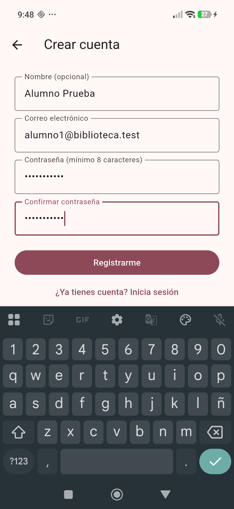

**Búsqueda pública en Open Library: 48 281 resultados en 0.8 s (P-02)**

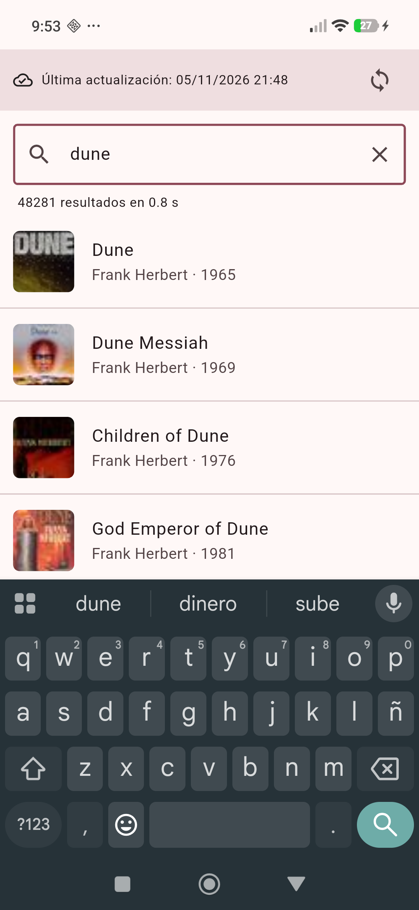

**Detalle de un libro con descripción real (P-02)**


**Favorito, estado «Leyendo» y calificación de 4 estrellas (P-01)**


**Favoritos conservados tras cerrar y abrir la app (P-05)**


**Recomendaciones con criterio y motivo por libro (P-06)**


**Consulta sin conexión: resultados guardados con su fecha (P-07)**

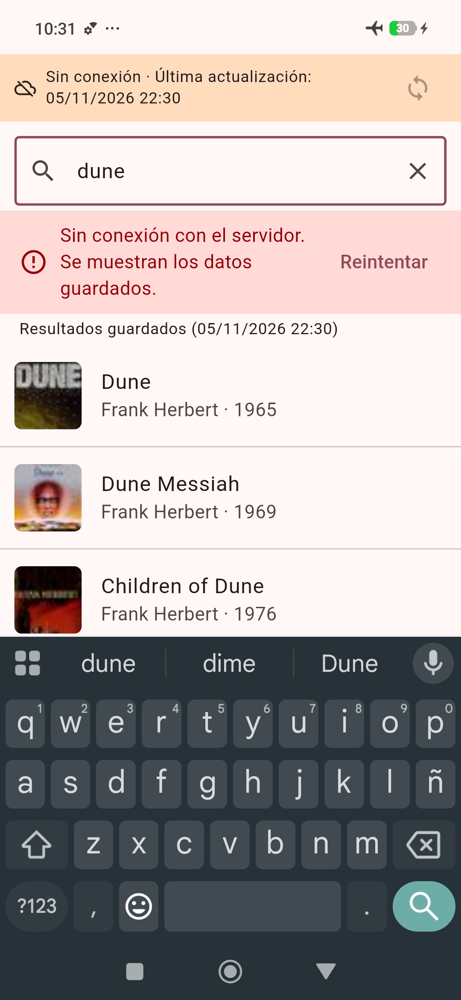

**Cambios hechos sin conexión quedan pendientes (P-08)**

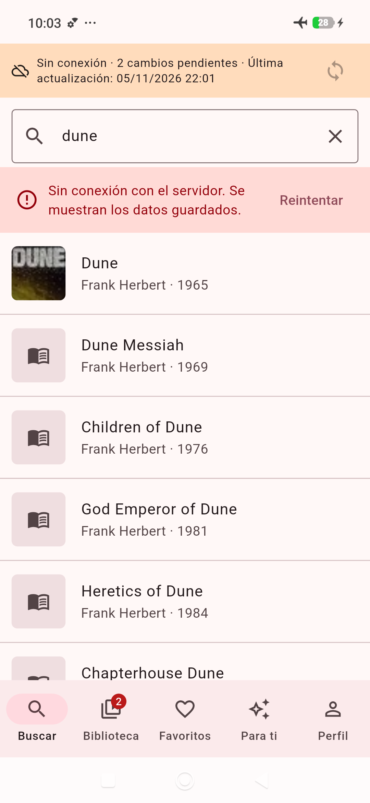

**Al reconectar se sincroniza solo y sin duplicados (P-08)**

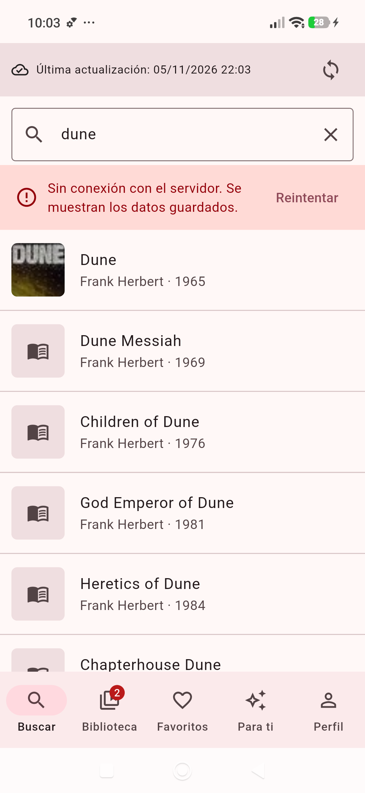

**Servidor caído: error visible y cambio pendiente (P-03)**


**Una cuenta nueva no ve los datos de otra (P-10)**


**Rol administrador: usuarios con sus contadores (P-14)**

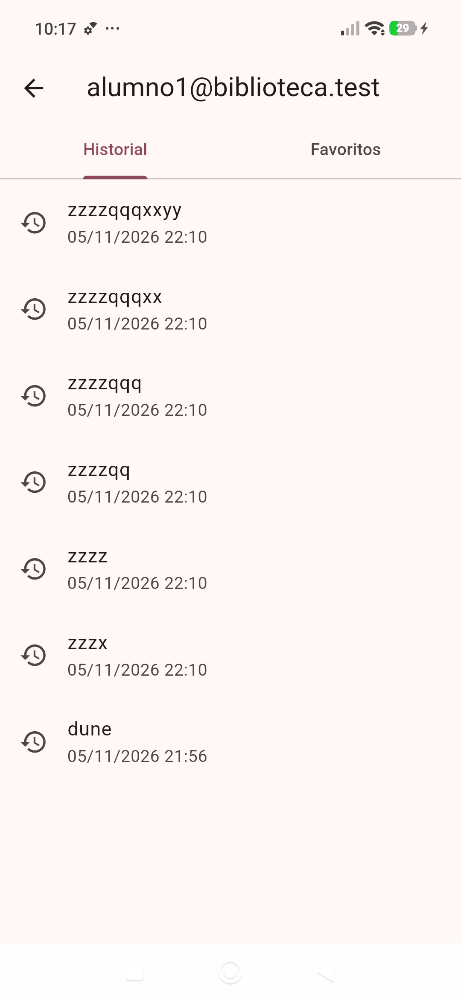

**Inicio de sesión con Google validado por el backend (P-04)**

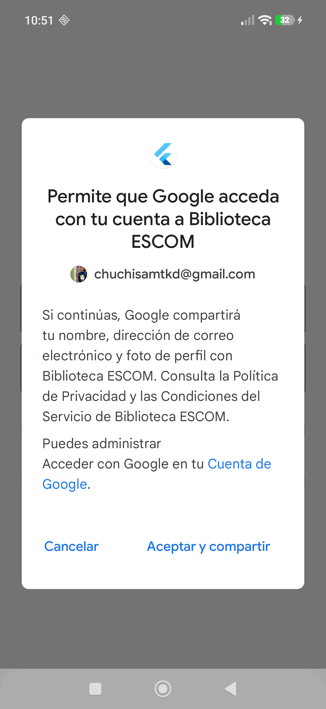

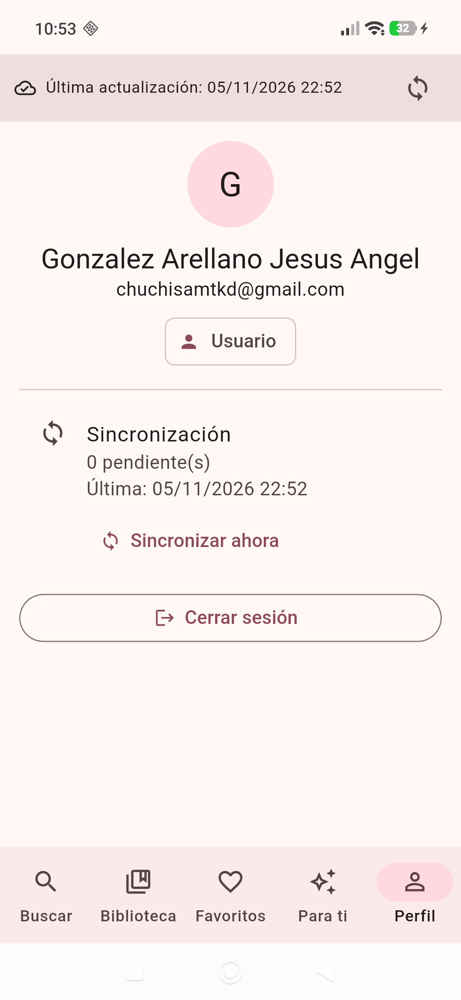

**Texto ampliado (escala 1.45) en Perfil (P-11)**

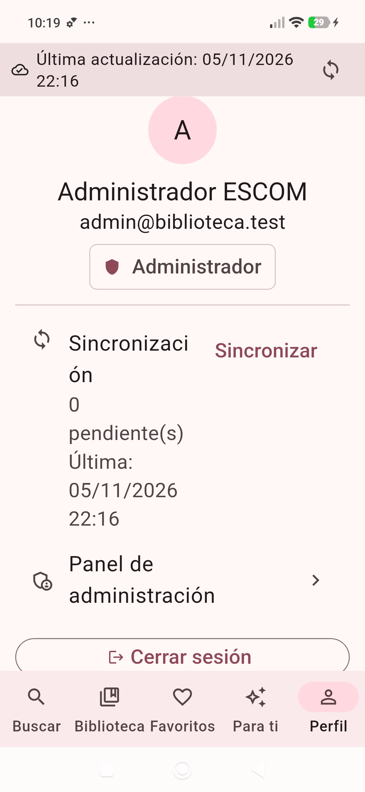

Evidencia adicional en texto: [`docs/evidencias/`](docs/evidencias/) (idempotencia de
`/sync`, 403 de administración, baja lógica en el servidor, etiquetas de accesibilidad).

### iOS (simulador iPhone Air, Codemagic)

Capturas del recorrido automático en un simulador iPhone Air (Xcode 26.6, runner Mac M2
de Codemagic). Detalle de lo cubierto en la sección 8 de
[`docs/pruebas.md`](docs/pruebas.md).

**Búsqueda pública en iOS: 48 281 resultados**

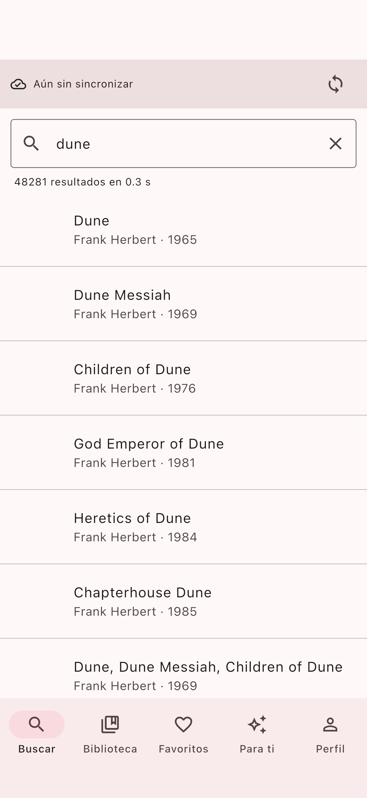

**Detalle con favorito y estado «Leyendo» en iOS**


**Recomendaciones en iOS (caso sin historial)**

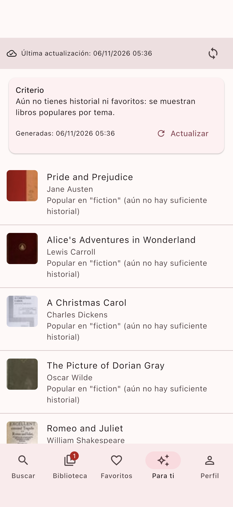

**Panel de administración en iOS**

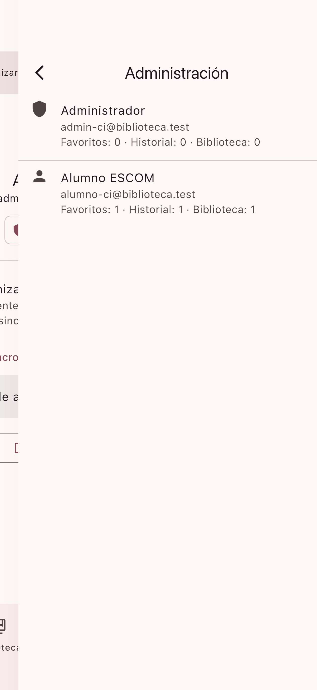

Verificación de roles en el runner: cuenta normal **403**, administrador **200**
([`docs/evidencias/ios-15-autorizacion-admin.txt`](docs/evidencias/ios-15-autorizacion-admin.txt)).

---

## Conclusiones

Antes de empezar pensaba que «funcionar sin conexión» era guardar una copia de lo
que se descarga. Al construirlo entendí que lo difícil es lo contrario: decidir qué
pasa con los **cambios** hechos sin red. Tuve que pensar en identificadores
generados en el cliente, en una cola que se pueda reenviar sin duplicar y en no
pisar con la descarga lo que aún no se había enviado. Ver el contador de pendientes
bajar a cero al quitar el modo avión, y comprobar en la base de datos que no había
duplicados, fue lo que más me convenció de que el diseño funcionaba.

Me sorprendió cuánto aportó probar en el celular con una guía de casos: salieron
defectos que ni el análisis estático ni mis pruebas automáticas habían mostrado
(autores «desconocidos» en las recomendaciones, fechas con seis horas de
diferencia, un historial lleno de fragmentos de lo que iba tecleando).

Usé Claude Code como asistente de programación, y lo declaro porque la práctica lo
pide; las decisiones de diseño y las pruebas en mi dispositivo las hice yo.

---

## Referencias (APA)

Flutter. (s. f.). *Flutter documentation*. https://docs.flutter.dev/

FastAPI. (s. f.). *FastAPI*. https://fastapi.tiangolo.com/

Google. (s. f.). *google_sign_in*. https://pub.dev/packages/google_sign_in

Internet Archive. (s. f.). *Open Library API*. https://openlibrary.org/developers/api

SQLite Consortium. (s. f.). *SQLite documentation*. https://www.sqlite.org/docs.html

---

<a id="english"></a>

# Practice 5 — ESCOM Library: public API queries and platform features on Android and iOS

## Cover

- **Name:** Jesús Ángel González Arellano
- **Group:** 7CV4
- **Course:** Native mobile application development
- **Professor:** Gabriel Hurtado Avilés
- **Due date:** Friday, November 6, 2026

## Summary

A single **Flutter** client for Android and iOS that queries the public **Open
Library** API, stores what it fetches in SQLite for offline use, keeps per-user
search history, favorites and a personal library, builds reproducible
**recommendations**, and syncs with the backend through an **idempotent operation
queue**. It includes e-mail sign-up/sign-in, a Google option and a server-validated
**administrator role**. The backend is the Practice 2 FastAPI service, extended; its
history is kept and the final Practice 2 state is tagged `practica2-base`
(commit `1f4e511`). Reused endpoints: `/auth/register`, `/auth/login`, `/tareas`.
New endpoints: `/auth/google`, `/auth/me`, `/auth/logout`, `/library`, `/favorites`,
`/history`, `/sync`, `/admin/*`.

## Requirements

Flutter 3.47.6, JDK 21, Android 7.0 (API 24)+ (tested on Android 16), iOS 15+
(building requires macOS + Xcode, or the CI workflow), Docker Compose, Python 3.12
for backend tests.

## Run it

**Backend**

```bash
cd backend
cp .env.example .env     # set random secrets; .env is never committed
docker compose up -d --build
docker compose exec backend python -m app.bootstrap_admin
```

**Android (physical device)**

```bash
cd app && flutter pub get
adb reverse tcp:8000 tcp:8000
flutter run -d <device-id> --dart-define=API_BASE_URL=http://127.0.0.1:8000
```

Plain HTTP is allowed only in the debug build; release builds require HTTPS.

**iOS** — on a Mac: `flutter run -d <simulator> --dart-define=API_BASE_URL=http://127.0.0.1:8000`.
Without a Mac, the main path is **Codemagic** (`codemagic.yaml`, M2 Mac runner, free
tier): it starts the backend (SQLite) on the runner, runs analysis, tests and the
integration walkthrough on an iPhone simulator and uploads the screenshots as an
artifact. A manual GitHub Actions workflow (`.github/workflows/ios.yml`) is kept as a
fallback.

**Google Sign-In** — see [`docs/google-oauth-setup.md`](docs/google-oauth-setup.md).
Client IDs live in untracked files; without them the app says Google is not
configured and never fakes a sign-in.

**Tests** — `flutter analyze && flutter test` (15) and `python -m pytest` (18).

## Evidence and test matrix

Screenshots (Xiaomi 25062PC34G, Android 16) are listed in the Spanish section above
and in [`docs/img/android/`](docs/img/android/). The full test matrix with real
results, defects found and fixed, and the verdict is in
[`docs/pruebas.md`](docs/pruebas.md) (Spanish). The iOS simulator results are in its section 8.

## Tools used

Claude Code (Anthropic) was used as a programming assistant for code, tests and
documentation; design decisions, device testing and publishing were done by the
author.
